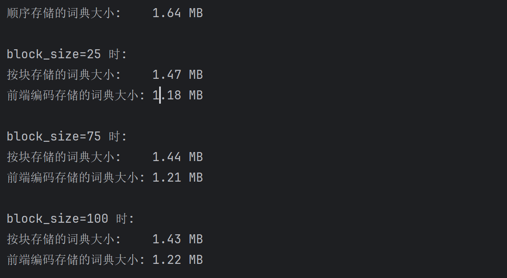
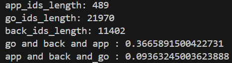
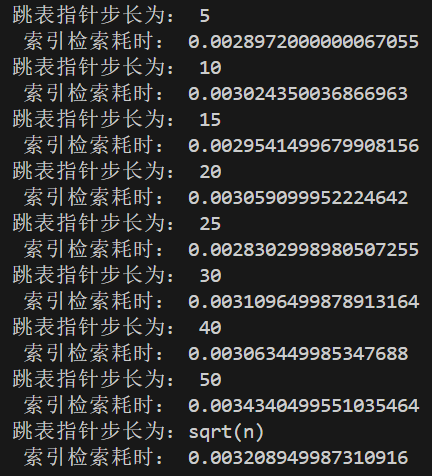
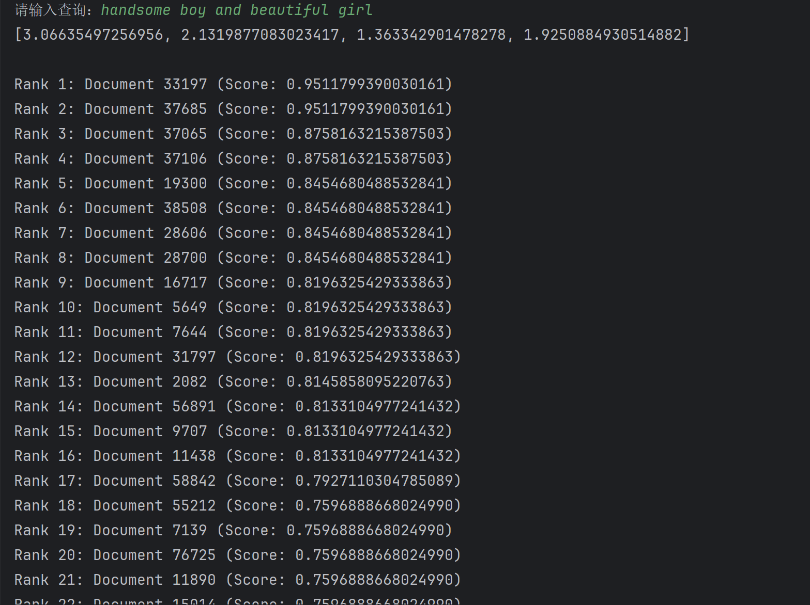
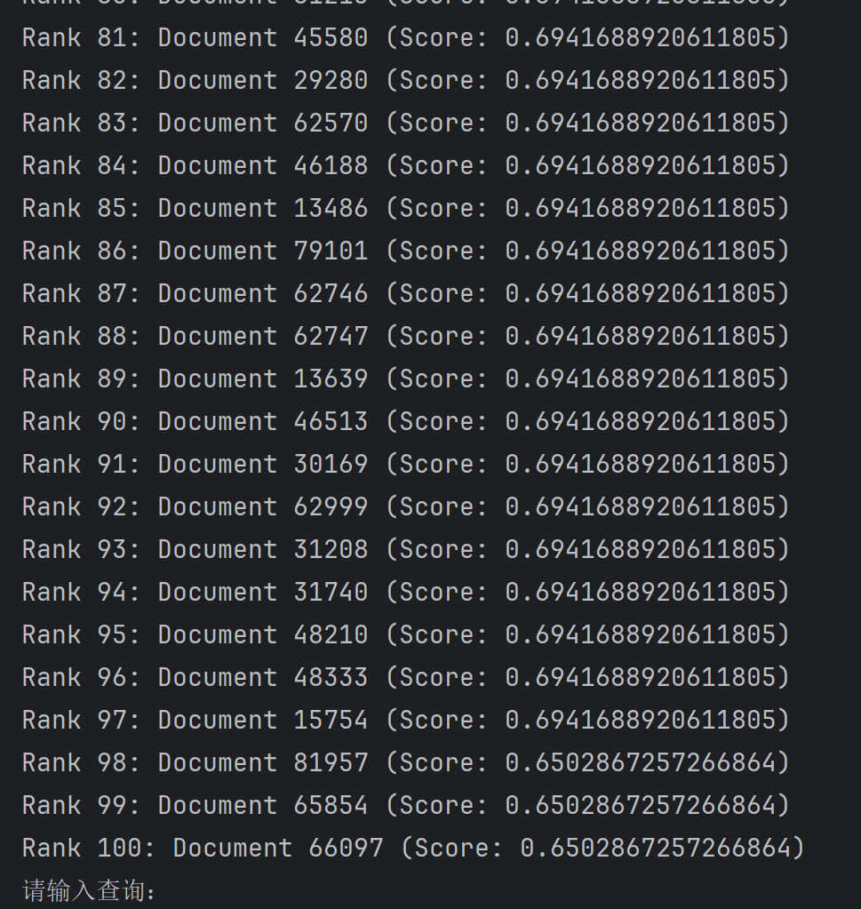

## **Web 信息处理实验 1**
### 小组成员：
* PB23111655 井旺波
* 

### 1.文档解析与规范化处理
**实现文件为 parse_xml.py**
总体采用NTLK库对文档进行解析和规范化处理

1. 获取文档对应字段（这里是description字段），函数：parse_group_file(filepath)
2. 规范化处理，函数：normalize_text(text)，最终返回一个规范的分词列表clean_tokens，处理步骤如下：
    1. 小写
    2. 去除特殊符号
    3. 分词
    4. 去除停用词&词干化
3. 为了方便短语处理，额外构建了一个不排除停用词的处理函数：normalize_text_full(text)，处理步骤如下：
    1. 小写
    1. 去除特殊符号
    1. 分词
    1. 词干化
### 2.倒排表的构建

**实现文件为 gen_inverted_index.py,Trie.py**
分为正排表构建，词典构建和倒排表构建等步骤

* 正排表结构:  

  ```python
  docs = {
      file1:[word1, word2, ...],
      file2:[word3, word4, ...],
      ...
  }
  ```

* 倒排表构建以及查询时词典的结构都主要是 Trie 树，其结构如下：
  
  <svg width="800" height="450" version="1.1" xmlns="http://www.w3.org/2000/svg">
  	<ellipse stroke="black" stroke-width="1" fill="none" cx="371.5" cy="69.5" rx="30" ry="30"/>
  	<ellipse stroke="black" stroke-width="1" fill="none" cx="249.5" cy="155.5" rx="30" ry="30"/>
  	<text x="245.5" y="161.5" font-family="Times New Roman" font-size="20">t</text>
  	<ellipse stroke="black" stroke-width="1" fill="none" cx="377.5" cy="207.5" rx="30" ry="30"/>
  	<text x="371.5" y="213.5" font-family="Times New Roman" font-size="20">a</text>
  	<ellipse stroke="black" stroke-width="1" fill="none" cx="512.5" cy="155.5" rx="30" ry="30"/>
  	<text x="509.5" y="161.5" font-family="Times New Roman" font-size="20">i</text>
  	<ellipse stroke="black" stroke-width="1" fill="none" cx="154.5" cy="266.5" rx="30" ry="30"/>
  	<text x="148.5" y="272.5" font-family="Times New Roman" font-size="20">o</text>
  	<ellipse stroke="black" stroke-width="1" fill="none" cx="287.5" cy="281.5" rx="30" ry="30"/>
  	<text x="282.5" y="287.5" font-family="Times New Roman" font-size="20">e</text>
  	<ellipse stroke="black" stroke-width="1" fill="none" cx="200.5" cy="362.5" rx="30" ry="30"/>
  	<text x="194.5" y="368.5" font-family="Times New Roman" font-size="20">a</text>
  	<ellipse stroke="black" stroke-width="1" fill="none" cx="287.5" cy="393.5" rx="30" ry="30"/>
  	<text x="281.5" y="399.5" font-family="Times New Roman" font-size="20">d</text>
  	<ellipse stroke="black" stroke-width="1" fill="none" cx="377.5" cy="362.5" rx="30" ry="30"/>
  	<text x="370.5" y="368.5" font-family="Times New Roman" font-size="20">n</text>
  	<ellipse stroke="black" stroke-width="1" fill="none" cx="559.5" cy="266.5" rx="30" ry="30"/>
  	<text x="552.5" y="272.5" font-family="Times New Roman" font-size="20">n</text>
  	<ellipse stroke="black" stroke-width="1" fill="none" cx="491.5" cy="362.5" rx="30" ry="30"/>
  	<text x="484.5" y="368.5" font-family="Times New Roman" font-size="20">n</text>
  	<polygon stroke="black" stroke-width="1" points="346.98,86.785 274.02,138.215"/>
  	<polygon fill="black" stroke-width="1" points="274.02,138.215 283.44,137.693 277.678,129.519"/>
  	<polygon stroke="black" stroke-width="1" points="372.803,99.472 376.197,177.528"/>
  	<polygon fill="black" stroke-width="1" points="376.197,177.528 380.845,169.319 370.854,169.753"/>
  	<polygon stroke="black" stroke-width="1" points="397.112,85.121 486.888,139.879"/>
  	<polygon fill="black" stroke-width="1" points="486.888,139.879 482.662,131.444 477.455,139.981"/>
  	<polygon stroke="black" stroke-width="1" points="229.993,178.292 174.007,243.708"/>
  	<polygon fill="black" stroke-width="1" points="174.007,243.708 183.007,240.881 175.41,234.379"/>
  	<polygon stroke="black" stroke-width="1" points="258.162,184.222 278.838,252.778"/>
  	<polygon fill="black" stroke-width="1" points="278.838,252.778 281.315,243.675 271.741,246.562"/>
  	<polygon stroke="black" stroke-width="1" points="265.543,301.943 222.457,342.057"/>
  	<polygon fill="black" stroke-width="1" points="222.457,342.057 231.719,340.266 224.905,332.947"/>
  	<polygon stroke="black" stroke-width="1" points="287.5,311.5 287.5,363.5"/>
  	<polygon fill="black" stroke-width="1" points="287.5,363.5 292.5,355.5 282.5,355.5"/>
  	<polygon stroke="black" stroke-width="1" points="309.799,301.569 355.201,342.431"/>
  	<polygon fill="black" stroke-width="1" points="355.201,342.431 352.6,333.363 345.91,340.796"/>
  	<polygon stroke="black" stroke-width="1" points="542.159,290.981 508.841,338.019"/>
  	<polygon fill="black" stroke-width="1" points="508.841,338.019 517.545,334.381 509.385,328.601"/>
  	<polygon stroke="black" stroke-width="1" points="524.197,183.126 547.803,238.874"/>
  	<polygon fill="black" stroke-width="1" points="547.803,238.874 549.288,229.558 540.079,233.457"/>
  </svg>
  
* 倒排表结构: 
```python
'''倒排表最终结构，词典被分开用trie树存储'''
inverted_index = [
    [
        {   #postings，文档ID-位置信息
            0 : [5, 23, 87],
            1 : [1],
            3 : [12, 43],
            5 : [7],
            8 : [9]
        },
        {   #skip_pointers,跳表指针
            0 : 3,
            3 : 8
        }
    ],
    #...
]
```
1. 构建正排表，函数：parse_all(folder)，结果返回一个字典，处理步骤如下：
   1. 遍历文件夹下的所有文件获取规范化处理的各个字段
   2. 构建正排表，将字段值作为value，文件名作为key

     > 注意这里同样有函数parse_all_full(folder)来获取不排除停用词的正排表
2. 构建倒排表，函数：gen_inverted_index(documents)，结果返回一个字典，处理步骤如下：
   1. 通过正排表来获取文档名和字段信息
   2. 遍历每个字段，将每个词存入倒排表中，记录词出现的位置：field_id:[positions]，同时补全id_name的内容。（即倒排表当中存储的时文件id，实际文件名需要后续通过id_name提取）
   3. 遍历倒排表，设置跳表指针，有固定长度指针，也有sqrt(n)长度指针 
3. 还另外设置了函数：compress_inverted_index(documents)来构建压缩倒排表，这里的压缩指的是把词项在文档当中的位置信息改为了两次出现的间隔。
   * 具体操作与gen_inverted_index(documents)一致，只在存入位置信息时做了修改，改为了存储间隔。
4. 通过split_index(inverted_index_pre)函数将初步生成的结果分成两个部分，即词典和倒排表。（inverted_index_pre当中仍然通过token进行索引，通过该函数可以实现拆分，使得字典当中存储的是token以及其对应的倒排索引，而倒排表当中存储的是则完全是倒排索引所对应的词项位置信息）

### 3.倒排表的扩展与优化 [

#### 1.在倒排表中加入词项的位置信息，以应对短语检索需求。

> 词项的位置信息在上一步构建倒排表中已经添加。具体实现也已经介绍过。

#### 2.任选两种课程中介绍过的索引压缩方法加以实现，如按块存储、前端编码等，并比较压缩后的索引在存储空间上与原索引的区别。

- 实现了按块存储、前端编码两种索引压缩方法, 存储结构如下:

  > 查询时词典主要采用 Trie 树结构, 对于 Trie 树的压缩和解压函数写在了 Trie 类里

  1. 顺序存储

     > 词典列表和倒排索引(词项对应的倒排表的索引下标)的列表

     ```py
     [word1, word2, ...]
     [pos1, pos2, ...]
     ```

  2. 按块存储

     > 两个部分:
     >
     > 1. 块的信息(存储倒排索引以及对应块在长字符串中的索引), 
     > 2. 长字符串(每个词项由词项长度分割)

     ```python
     """词典按块存储的结构"""
     dictionary_blocking = [
         (
             [3,6,133,269],
             0   #第0个word的索引
         ),
         (
             [2,4,7,9],
             16  #第4个word的索引
         ),
         #...
     ]
     long_string = "...7systile9syzygetic8syzygial6syzygy11szaibelyite8szczecin..."
     ```

  3. 前端编码

     > 两个部分:
     >
     > 1. 块的信息, 
     > 2. 长字符串(每个词项由词项长度分割)

     `````python
     """词典前端编码结构"""
     dictionary_fronting = dictionary_blocking  #块的信息和按块存储结构一样
     # 前缀长度 + 第一个单词 + 各个(后缀长度 + 后缀)
     long_string = "7automata1e2ic3ion"
     `````

- 压缩后的索引在存储空间上与原索引的区别测试如下:

  

- 通过输出结果可以看到按块存储压缩后节约了将近 $10\%$的空间，而前段编码的压缩方式又在前段编码的基础上节约了大约$15\%-20\%$ 的空间。

  > 同时可以发现块大小的增加对于空间节约方面收益不多, 而对于检索效率可能产生较大影响.

### 4.多种形式的信息检索

**实现文件为 search.py**

#### 1.布尔检索
1. 处理输入文段，对其进行规范化处理，这里保留'and'、'or'、'not'（三个词在停用词表中，不能删除），同时保留括号
   ```python
   def bool_evaluator(text):
    #小写
    text=text.lower()
    # 去掉特殊符号（保留单词和空格,和括号）
    text = html.unescape(text)  # 转回 <p>Our purpose:</p>
    text = re.sub(r"<.*?>", "", text)  # 去掉 <p> 和 </p>
    text = re.sub(r"[^a-z\s()]", " ",  text) #把除了字母和空白符号的其他符号换成空格
    # 分词
    tokens = word_tokenize(text)#分词
    clean_tokens = []
    for word in tokens:
        if word not in stop_words:
            clean_tokens.append(stemmer.stem(word))
        elif word=='or' or word=='and' and clean_tokens[-1] not in ['or','and','not'] :#暂时每个运算都得带上括号
            clean_tokens.append(word)
        elif word=='not' and clean_tokens[-1] != 'not' :
            clean_tokens.append(word)
    return clean_tokens
   ```
2. 根据规范化好的文段进行进一步规范，通过增加括号的方式来明确布尔查询各种运算词之间的优先级。（后续只需要识别括号的优先级就可以了）
函数：
* 处理数组嵌套
    ```python
    def flatten_to_1d(nested_structure): #递归处理，将多维数组转化为一维数组
    """
    将嵌套结构转换为一维数组
    """
    result = []
    
    def flatten(item):
        if isinstance(item, list):
            for subitem in item:
                flatten(subitem)
        else:
            result.append(item)
    
    flatten(nested_structure)
    return result
    ```
* 处理最小文段
    ```python
    #该函数作用为给一个不含括号的表达式添加括号
    def add_parentheses_temp(output):
        """处理括号"""
        # result = output.copy()
        for j in range(2):
            if j == 0:
                length = len(output)
                i = 0
                while i < length:
                    if output[i]=='not':
                        if type(output[i+1]) == list :
                            output[i+1] =['( '] + [' not '] + output[i+1] + [' )']
                        else:
                            output[i] = ['('] + [output[i]]  +  [output[i+1]] + [')']
                        del output[i+1]
                        length -= 1
                    i += 1
            if j == 1:
                length = len(output)
                i = 0
                while i < length:
                    if output[i]=='and':
                        if type(output[i-1]) == list and type(output[i+1]) == list:
                            output[i] =['(']+ output[i-1] + ['and'] + output[i+1] +[')']
                        elif type(output[i-1]) == list and type(output[i+1]) != list:
                            output[i] =['(']+ output[i-1] + ['and'] + [output[i+1]] +[')']
                        elif type(output[i-1]) != list and type(output[i+1]) == list:
                            output[i] =['(']+ [output[i-1]] + ['and'] + output[i+1] +[')']
                        else:
                            output[i] =['(']+ [output[i-1]] + ['and'] + [output[i+1]] +[')']
                        del output[i-1]
                        del output[i]
                        length -= 2
                    i += 1
        output.insert(0, '(')
        output.append(')')
        return output
    ```
* 处理所有文段
    ```python
    # 处理布尔表达式，通过栈递归到不含括号的最大表达式，依次添加括号
    # （添加完成后看作一个整体，以数组整体为一个元素的形式直接存入结果数组，后续添加括号时直接看作一个元素处理）
    def add_parentheses(clean_tokens):
        stack = []
        output = []
        for i in range(len(clean_tokens)):
            if clean_tokens[i]=='(':
                stack.append(clean_tokens[i])
            elif clean_tokens[i]==')' :
                while stack and stack[-1]!='(':
                    output.insert(0,stack.pop())
                stack.pop()
                temp = add_parentheses_temp(output)   #再构建一个函数处理output
                stack.append(temp)
                output = []
            else:
                stack.append(clean_tokens[i])
        while stack:
            output.insert(0,stack.pop())
        result = add_parentheses_temp(output)
        result = flatten_to_1d(result)
        return result
    ```
3. 将规范好的文本转换为后缀表达式（逆波兰表达式）
2. 将逆波兰表达式转换为布尔查询树
   函数：
    ```python
    def _build_syntax_tree(tokens):
           # """构建布尔查询树 (使用Shunting-yard算法)"""
           output = []
           stack = []
        #处理传入的文段，将其转化为后缀表达式
           for token in tokens:
               if token == '(':
                   stack.append(token)
               elif token == ')':
                   while stack and stack[-1] != '(':
                       output.append(stack.pop())
                   stack.pop()  # 弹出左括号
               elif token in {'and', 'or'}:
                   while stack and stack[-1] in {'and', 'or', 'not'}:#必须有这个才能获得正确的计算顺序
                       output.append(stack.pop())
                   stack.append(token)
               elif token == 'not':
                   stack.append(token)
               else:  # 词项
                   output.append({
                       'type': 'term',
                       # 'parent': None,
                       'value': [token]
                       })
   
           # 弹出剩余运算符
           while stack:
               output.append(stack.pop())
   
        #处理后缀表达式，构建查询树
           tree_stack = []
           for elem in output:
               if isinstance(elem, dict):  # 词项
                   tree_stack.append(elem)
               elif elem == 'not':
                   operand = tree_stack.pop()
                   tree_stack.append({
                       'type': 'operator',
                       # 'parent': None,
                       'operator': 'not',
                       'operand': operand
                   })
               else:  # and/or
                   right = tree_stack.pop()
                   left = tree_stack.pop()
                   tree_stack.append({
                       'type': 'operator',
                       # 'parent': None,
                       'operator': elem,
                       'left': left,
                       'right': right
                   })
                   # left.parent = tree_stack[-1]
                   # right.parent = tree_stack[-1]
   
           return tree_stack[0] if tree_stack else None
    ```
    注意3、4的实现都需要使用栈来保证正确的顺序，且3、4的都在函数_build_syntax_tree(tokens)中实现
5. 递归算法遍历布尔查询树，输出检索结果。
    函数：
    ```python
    def recursive_search_skip(tree, dictionary, inverted_index, id_name_list):
    # """递归计算布尔表达式语法树"""
    if tree['type'] == 'term':
        return search_word_skip(tree['value'][0], dictionary, inverted_index)
    elif tree['type'] == 'operator':
        if tree['operator'] == 'and':
            if tree['left']['type'] == 'term' and tree['right']['type'] == 'term':
                left_result = recursive_search_skip(tree['left'], dictionary, inverted_index, id_name_list)
                right_result = recursive_search_skip(tree['right'], dictionary, inverted_index, id_name_list)     
                return AND_SKIP(left_result, right_result)
            else:     
                left_result = recursive_search_skip(tree['left'], dictionary, inverted_index, id_name_list)
                right_result = recursive_search_skip(tree['right'], dictionary, inverted_index, id_name_list)
                if type(left_result[0]) == dict:
                    left_result = list(left_result[0].keys())
                if type(right_result[0]) == dict:
                    right_result = list(right_result[0].keys())
                return AND(left_result, right_result)
        elif tree['operator'] == 'or':
            left_result = recursive_search_skip(tree['left'], dictionary, inverted_index, id_name_list)
            right_result = recursive_search_skip(tree['right'], dictionary, inverted_index, id_name_list)
            if type(left_result[0]) ==dict:
                left_result = list(left_result[0].keys())
            if type(right_result[0]) == dict:
                right_result = list(right_result[0].keys())
            return OR(left_result, right_result)
        elif tree['operator'] == 'not':
            operand_result = recursive_search_skip(tree['operand'], dictionary, inverted_index, id_name_list)
            if type(operand_result[0]) == dict:
                operand_result = list(operand_result[0].keys())
            return NOT(id_name_list, operand_result)
    ```
    应当注意到跳表指针只在两个单一词项进行合并操作时才会起作用，因此计算方式如下：
    （这里有两种and操作，一个是使用跳表指针时的and操作，一个是其他情况的and操作，由于使用了set()函数，但是AND_SKIP函数会返回倒排表，无法作为set()的参数，因此上面的搜索函数会在检测到不适用跳表指针情况是将倒排表转化为列表）
    ```python
        # 直接返回一个倒排表字典，即搜索出word所对应的倒排表
        def search_word_skip(word,dictionary, inverted_index):
            posting_index = dictionary.search(word)
            return inverted_index[posting_index]
        #用于计算其他的and操作
        def AND(arr1, arr2):
        return list(set(arr1) & set(arr2))
        #用于计算使用跳表指针情况下的and操作
        def AND_SKIP(inverted_index_1,inverted_index_2):#使用跳表指针的优化合并，参数改为两个倒排表。
            temp_1 = list(inverted_index_1[0].keys())
            temp_2 = list(inverted_index_2[0].keys())
            temp_skip_1 = list(inverted_index_1[1].values())
            temp_skip_2 = list(inverted_index_2[1].values())
            length_1 = len(temp_1)
            length_2 = len(temp_2)
            results_ids = []
            i = 0
            j = 0
            while 1:
                if temp_1[i] < temp_2[j]:
                    if temp_1[i] in temp_skip_1:
                        for temp_id in temp_skip_1:
                            if temp_id < temp_2[j]:
                                i = temp_1.index(temp_id)+1
                            elif temp_id == temp_2[j]:
                                results_ids.append(temp_id)
                                i = temp_1.index(temp_id)+1
                                j += 1
                            else:
                                break
                    else:
                        i += 1 
                elif temp_2[j] < temp_1[i]:
                    if temp_2[j] in temp_skip_2:
                        for temp_id in temp_skip_2:
                            if temp_id < temp_1[i]:
                                j = temp_2.index(temp_id)+1
                            elif temp_id == temp_1[i]:
                                results_ids.append(temp_id)
                                j = temp_2.index(temp_id)+1
                                i += 1
                            else:
                                break
                    else:
                        j += 1
                elif temp_1[i] == temp_2[j]:
                    results_ids.append(temp_1[i])
                    i += 1
                    j += 1
                if i >= length_1-1 or j >= length_2-1:
                    break
            return results_ids
    
        def OR(arr1, arr2):
        return list(set(arr1) | set(arr2))
    
        def NOT(arr1, arr2):#返回arr1中有arr2中没有的元素
            return list(set(arr1) - set(arr2))
    ```
6. 相关问题解答
    **注意这里的测试都是经过多次循环取中位数的获得的结果，从而降低其他因素引起的时间波动对结果的影响**
   （1） 分析同一个布尔表达式的不同处理顺序对时间开支的影响。
   举例测试代码如下：
   ```python
    docs = load_pickle(DOCUMENTS)
    dictionary, inverted_index, id_name = load()
   
    ids_word_1 = search_word('app', dictionary, inverted_index)
    ids_word_2 = search_word('go', dictionary, inverted_index)
    ids_word_3 = search_word('back', dictionary, inverted_index)
   
    print("app_ids_length:",len(ids_word_1))
    print("go_ids_length:",len(ids_word_2))
    print("back_ids_length:",len(ids_word_3))
   
    text_1 = "go and back and app"
    text_2 = "app and back and go"
   
    time_1_skip = []
    for i in range(500):
        start = time.perf_counter()
        search_result_1_skip = bool_search_skip(text_1, dictionary, inverted_index, id_name)
        end = time.perf_counter()
        time_1_skip.append(end - start)
   
    time_2_skip = []
    for i in range(500):
        start = time.perf_counter()
        search_result_2_skip = bool_search_skip(text_2, dictionary, inverted_index, id_name)
        end = time.perf_counter()
        time_2_skip.append(end - start)


    print(text_1, ":", statistics.median(time_1_skip))
    # print("bool_search_skip_result_1:",search_result_1_skip)
    print(text_2, ":", statistics.median(time_2_skip))
    # print("bool_search_skip_result_2:",search_result_2_skip)
    ```
   结果如图:
   
   分析： 
    按照每个word的查询结果从小到大执行结果的合并操作时，检索效率最高。因为and本质上就是倒排表的合并操作，合并的倒排表越小，效率越高，而且后续获得的中间结果也会较小，进一步使得之后的每次合并都会有较高的合并效率。
   （2) 选择不同的跳表指针步长，并分析其对存储性能/检索效率的影响。
   举例测试代码如下：

   ```python
    text = "(app and ap) and (op and p) or (go and back) and (close and home)"
    SKIP_STEP = [5,10, 15, 20, 25, 30, 40, 50]
    COUNT = 500

    for i in range(len(SKIP_STEP)):
        time_1 = []
        PATH = fr"{BASE_PATH}\inverted_index\skip_step_{SKIP_STEP[i]}\inverted_index.pkl"
        id_name = load_pickle(ID_NAME)
        inverted_index = load_pickle(PATH)
        dictionary = Trie.decompress_from_blocking(load_pickle(DICTIONARY_BLOCKING))
        for j in range(COUNT):
            start_time = time.perf_counter()
            search_result = bool_search(text, dictionary, inverted_index, id_name)
            end_time = time.perf_counter()
            time_1.append(end_time - start_time)
        print("跳表指针步长为：",SKIP_STEP[i],"\n","索引检索耗时：",statistics.median(time_1))
        # print("索引检索结果：", search_result)

    dictionary, inverted_index, id_name = load() #默认跳表指针步长为sqrt(n)
    time_1 = []
    for j in range(COUNT):
        start_time = time.perf_counter()
        search_result = bool_search(text, dictionary, inverted_index, id_name)
        end_time = time.perf_counter()
        time_1.append(end_time - start_time)
    print("跳表指针步长为：sqrt(n)","\n","索引检索耗时：", statistics.median(time_1))
    # print("索引检索结果：", search_result)
   ```
   结果如图：
   
   分析：
   * 步长过小：每次比较的代价较小，跳跃之后再次返回的可能性较小，但是跳跃步长太小，导致跳跃次数增多，检索效率下降
   * 步长过大：虽然跳跃步数少，但每次比较的代价增加，跳跃之后再次返回的可能性增大
   * 因此需要找到步长的平衡点来平衡跳跃次数和跳跃之后的返回可能性，进而得到最佳的检索效率


#### 2.向量空间模型
1. 处理输入文段，对其进行规范化处理
2. 通过搜索输入文段，确定需要计算相似度的文档id。（只要含有输入文段当中的单词，就需要计算相似度）
   这里采用了bool检索的方式来确定需要计算相似度的文档id的集合，即每个词项之间采用'or'运算
   1、2代码如下：
   ```python
    #规范化输入的文本
    texts_origin = normalize_text(texts_original)
    #更改为布尔检索模式
    texts = ""
    i=0
    len_texts = len(texts_origin)
    for text in texts_origin:
        texts += text
        i+=1
        if i<len_texts:
            texts+= " or " #中间采用'or'连接
    # print(texts)
    ids = bool_search(texts,dictionary, inverted_index, id_name)
   ```
3. 计算词项对应的IDF
   根据IDF计算公式：
   $$\mathrm{IDF}(t) = \log_{10}\frac{N}{df(t)}$$
   代码如下：
   ```python
   def compute_idf(doc,text,dictionary,inverted_index):#doc代表一个文档集合,这里只计算一个单词的逆文档频率
    text_idf = 0
    N = len(doc)
    ids_text = search_word(text,dictionary, inverted_index)
    df = len(ids_text)
    if df == 0:
        return 0.0
    text_idf = math.log10(float(N) / float(df))
    return text_idf
   ```
4. 计算每个词项在每个文档中的TF
   这里尝试了多种tf计算方法：
    $$\mathrm{TF}(t,d) = f_{t,d}$$
    $$\mathrm{TF}(t,d) = \frac{f_{t,d}}{F_d}$$
    $$\mathrm{TF}(t,d) = 0.5*f_{t,d} + 0.5*\frac{f_{t,d}}{F_d}$$
    $$\mathrm{TF}(t,d) = 1+\log_{10}f_{t,d}$$
    这里f_{t,d}为词项t在文档d中的出现次数，F_d为文档d中的总词项数
    代码如下：
    ```python
    #计算词频
    def compute_tf(text,dictionary, inverted_index,id_name,doc,id):
        #tf是相对于每一篇文档而言的，即该单词在该文档中出现的次数/该文档的长度
        #doc为所代表文档集合的正排表
        #这里计算了一个词在一个文档（id）中的词频
        #返回一个字典，只不过只有一个键值对
        position_index = dictionary.search(text)
        tf_text={}
        if id not in inverted_index[position_index][0]:
            tf_text[id] = 0
            return tf_text
        else:
                text_len = len(inverted_index[position_index][0][id])
                id_len = count_words(doc,id,id_name)
                tf_text[id] = math.log10(float(text_len)) + 1
                # tf_text[id] = float(text_len)/float(id_len)
                # tf_text[id] = float(text_len)
                # tf_text[id] = 0.5*float(text_len)/float(id_len) + 0.5*float(text_len)
        return tf_text
    ```
5. 计算TF-IDF
   代码如下：
   ```python
    # 计算TF-IDF
    def compute_tf_idf(text,id,doc,dictionary,inverted_index,id_name):#单词text，文档id
        tf_idf = 0
        text_idf = compute_idf(doc,text,dictionary,inverted_index)
        tf_text = compute_tf(text,dictionary, inverted_index,id_name,doc,id)
        tf_idf = tf_text[id] * text_idf#每个文档对应的tf-idf,
        return tf_idf
    
   ```
6. 采用计算余弦相似度的方式来计算文档之间的相似度
   代码如下：
   ```python
   def cosine_similarity(vec1, vec2):
    #"""计算两个向量的余弦相似度"""
    # 点积
    dot_product = sum(float(a) * float(b) for a, b in zip(vec1, vec2))
    # print(dot_product,"\n")
    # 向量模长
    magnitude1 = math.sqrt(sum(float(a)**2 for a in vec1))
    magnitude2 = math.sqrt(sum(float(a)**2 for a in vec2))
    # print(magnitude1,"\n")
    # print(magnitude2,"\n")
    # print(dot_product / (magnitude1 * magnitude2),"\n")
    # 避免除零错误
    if magnitude1 == 0 or magnitude2 == 0:
        return 0.0
    
    return dot_product / (magnitude1 * magnitude2)
   ```
7. 为每个文档构建的TF-IDF向量
8. 计算输入文段对应的TF-IDF向量
9. 给文档按相似度降序排序，输出前100个结果,不够100就输出所有结果
   7、8、9三个步骤在一个函数中实现：
   ```python
   #注意这里需要bool的最终搜索结果来确定需要参与计算的文档长度
    #对一定的文档集合进行检索
    def TF_IDF_search(texts_original,ids,dictionary, inverted_index,id_name,doc):
        # 对输入的文本进行预处理,即分词和规范化
        # 有没有这一步其实都行，反正提前布尔检索已经规范化过了
        texts = normalize_text(texts_original)
   
        word_texts_tf = compute_texts_tf(texts)
   
        if not ids:  # 如果输入的文本为空，则返回空字典
            return print("No results found.")
   
        tf_idf = 0
        vec = {}
        vec_search = []
   
        # 7.为每个文档构建的TF-IDF向量，注意输入文本在删去重复单词之后的长度就是向量长度，这里用is_first_occurrence来判断一个单词是否已经出现过
        for id in ids:
            vec[id]=[]
            is_first_occurrence = []
            for text in texts:
                if text not in is_first_occurrence:
                    is_first_occurrence.append(text)
                    tf_idf=compute_tf_idf(text,id,doc,dictionary, inverted_index,id_name)
                    vec[id].append(tf_idf)
        is_first_occurrence = []
        #8.计算输入文段对应的TF-IDF向量
        for text in texts:# 计算搜索文本的TF-IDF向量
            if text not in is_first_occurrence:
                is_first_occurrence.append(text)
                idf_search = compute_idf(doc,text,dictionary, inverted_index)
                tf_search = word_texts_tf[text]
                vec_search.append(idf_search*tf_search)
        print(vec_search,"\n")
        results = {}
        # 依次计算每个文档与输入文段的相似度
        for id in ids:
            sim = cosine_similarity(vec[id],vec_search)
            # print(vec[id],"\n")
            # print(vec_search,"\n")
            # print(sim,"\n")
            results[id]=sim
        # 9. 给文档按相似度降序排序，输出前100个结果,不够100就输出所有结果
        sorted_results = sorted(results.items(), key=lambda x: x[1], reverse=True)
        # 输出排序结果
        for rank, (doc_id, score) in enumerate(sorted_results, 1):
            if rank > 100:
                break
            print(f"Rank {rank}: Document {doc_id} (Score: {score:.16f})")
   ```
10. TF-IDF检测代码如下:
    ```python
    # ## TF-IDF 搜索,不需要输入布尔表达式，直接输入句子就行
    while True:
        text = input("请输入查询：")
        if text == "###":
            break
        # search_result = bool_search(text, dictionary, inverted_index, id_name)
        # print(search_result,"\n")
        TF_IDF_search_not_bool(text, dictionary, inverted_index, id_name, docs)
    ```
 * 一次TF-IDF检索的结果：
    
    

### 实验总结